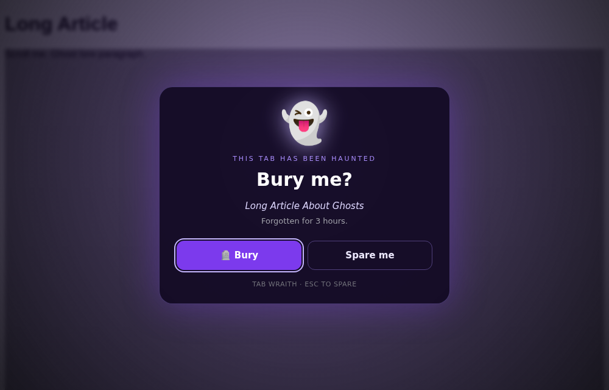
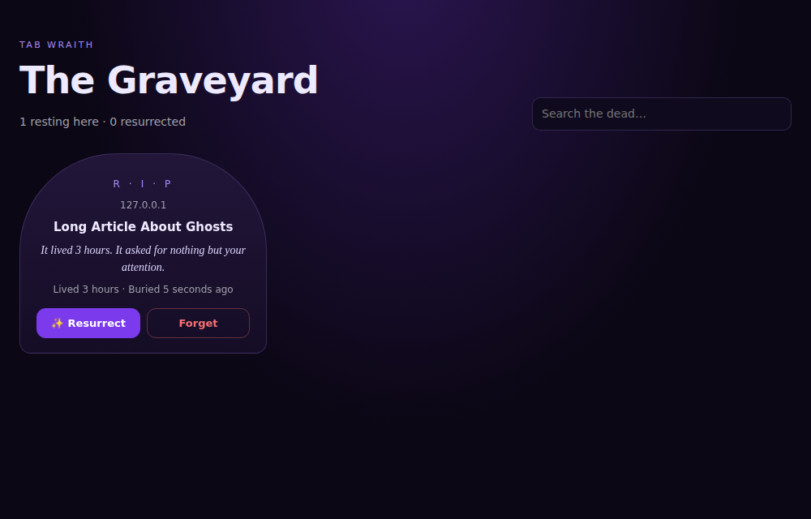

# 👻 Tab Wraith

**Your abandoned tabs don't close. They die.**

Tab Wraith is a Chrome extension that haunts the tabs you forgot about. Untouched tabs slowly
drain of color, then a ghost confronts you and asks to bury them. Every buried tab gets an
epitaph and a tombstone in the Graveyard, where you can resurrect it at the exact spot you left off.

Built solo for **Hackyard** (theme: *build something that haunts, creeps into something real,
and actually works*). It creeps into your real browser and actually fixes tab hoarding.




**Demo (19s):** [github.com/goodfindfactory/wraith/blob/main/docs/demo.mp4](docs/demo.mp4)

## Install
1. Download or clone this repo (or grab the zip from the latest CI run).
2. Open `chrome://extensions` and turn on **Developer mode**.
3. Click **Load unpacked** and choose the `extension/` folder.
4. Pin the 👻 icon. Optional: open Settings and add an Anthropic API key for AI-written epitaphs.

## Features
- **The Watcher:** tracks when you last looked at each tab.
- **The Haunting:** past the threshold (default 30 min) a tab fades to gray with 👻 in its title;
  viewing it revives it. At 2× it becomes a wraith: flicker, ☠️ title, and a ghost asking *"Bury me?"*
- **The Burial:** saves title, address, icon, scroll position and lifespan, then closes the tab.
- **The Epitaph:** an AI writes a darkly funny one-line inscription, with built-in epitaphs as a fallback.
- **The Graveyard:** searchable tombstones with **Resurrect** (restores scroll position) and **Forget**.
- **The Popup:** live counts, **Demo Mode** (30-second haunting), **Exorcise** all wraiths, **Never haunt this site**.
- **Settings:** threshold, sound, never-haunt list, API key, model, empty the graveyard.

## Safety and privacy
- Never haunts pinned tabs, tabs playing audio, browser pages, or your never-haunt list
  (Gmail, Calendar, Meet and localhost by default). Never closes anything without your click.
- All data stays in your browser. Only with an API key set, a buried tab's title, address and a
  500-character excerpt are sent to Anthropic to write its epitaph.

## Development
```bash
npm install
npx playwright install chromium
npm test          # 57 end-to-end checks in a real Chromium (~2.5 min, includes a live Demo Mode wait)
npm run package   # builds dist/tab-wraith-v<version>.zip
```
CI (GitHub Actions) runs the tests and uploads the packaged zip on every push.

## Repo layout
```
extension/   the Chrome extension (Manifest V3) — load this folder
tests/       e2e.js test harness + fixtures/ test pages
scripts/     package.sh
docs/        EXTENSION_GUIDE.md (demo script + pitch), screenshots
GROK_PROMPT.md  prompt used to set up this repo
```

## Pitch
"Your abandoned tabs don't close, they die. Tab Wraith haunts what you forgot, buries it with an
epitaph, and lets you resurrect it."

## License
MIT © 2026 Kevin
